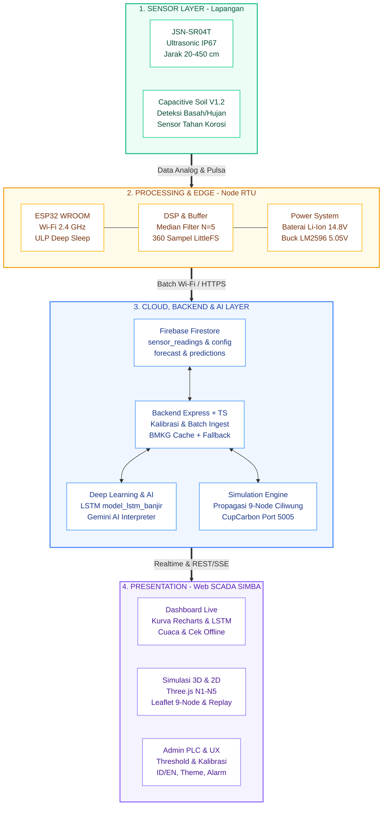
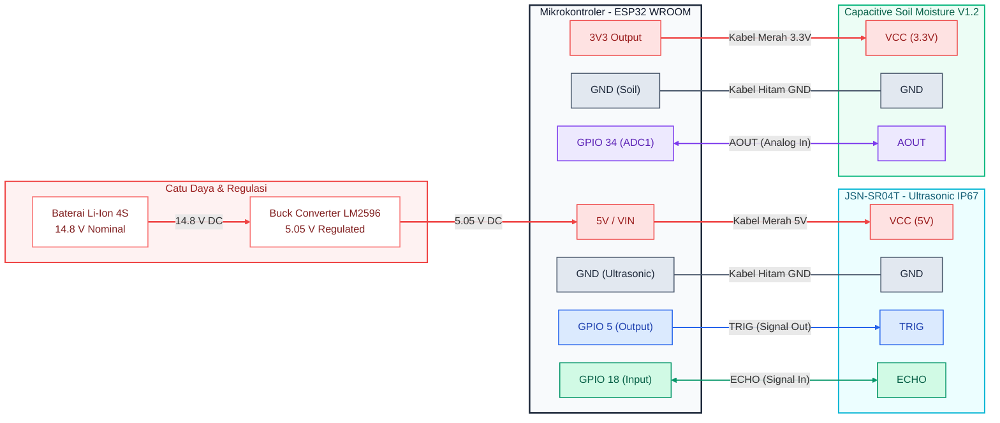

# 🌊 SIMBA — Sistem Prediksi Elevasi Air Sungai Berbasis Deep Learning & Web SCADA

> **Sistem Prediksi Elevasi Air Sungai Berbasis Deep Learning Menggunakan Fusi Data Sensor Ultrasonik dan Prakiraan Cuaca BMKG Terintegrasi Web SCADA**  
> **Capstone Project — Kelompok 12**

[](#stack-teknologi-aplikasi)
[](#arsitektur-sistem-4-lapisan)
[](#model-deep-learning-lstm)
[](#1-perangkat-keras-hardware--realisasi-node-iot)

---

## 📌 Latar Belakang & Solusi

Indonesia menghadapi ancaman banjir berskala besar setiap tahunnya. Berdasarkan data BNPB 2024:
- **1.420** kejadian banjir sepanjang tahun 2024
- **109,6 juta** jiwa terpapar risiko banjir (lebih dari sepertiga penduduk Indonesia)
- **49,77 juta hektar** luas wilayah bahaya banjir nasional
- **489** korban jiwa akibat bencana banjir sepanjang 2024

**SIMBA** hadir sebagai solusi *Early Warning System* (EWS) drainase dan sungai koridor **Depok–Jakarta (DAS Ciliwung)** berbiaya terjangkau (estimasi prototipe ~Rp 1,1 juta/node, jauh di bawah sensor radar/LiDAR konvensional bernilai puluhan hingga ratusan juta per titik) yang memadukan tiga pilar utama:
1. **Fusi Data Sensor & Cuaca** — Menggabungkan pembacaan jarak permukaan air (**JSN-SR04T**), deteksi kondisi basah (**Capacitive Soil Moisture Sensor V1.2**), dan prakiraan cuaca aktual **API BMKG**.
2. **Prediksi Deep Learning LSTM** — Memprediksi tren elevasi air multi-horizon (**T+30 menit, T+1 Jam, T+3 Jam, dan T+6 Jam**) untuk memberikan *lead time* evakuasi bagi warga dan BPBD.
3. **Web SCADA Real-Time & Simulasi 3D** — Dashboard monitoring langsung dari *smartphone*/browser tanpa instalasi aplikasi, dilengkapi status **Normal / Siaga / Bahaya**, deteksi alat *offline*, asisten AI **Gemini**, serta simulasi visual **3D/2D DAS Ciliwung** dan jaringan sensor **CupCarbon**.

---

## 🏗️ Arsitektur Sistem (4 Lapisan)



---

## 👥 Tim Pengembang — Kelompok 12

| Nama Anggota | Fokus Kontribusi Utama |
|---|---|
| **Ekananda Zhafif Dean** | Lead Frontend Web SCADA, Dashboard UI/UX, Grafik LSTM, & Integrasi Web |
| **Muhammad Iqbal Alfajri** | Lead Backend Server (Express/TS), Cloud Firebase Firestore, API & Integrasi Hardware |
| **Naufal Hani Zakwan** | Simulasi 3D DAS Ciliwung (Three.js 5 Node N1–N5) & Simulasi Jaringan CupCarbon (9 Node) |
| **Mikhail Ayares** | Perancangan & Pengembangan Sistem Hardware/IoT & Integrasi Proyek |
| **Radithya Fawwaz Syahdi** | Perancangan Sistem, Analisis Data, & Pengujian Proyek |

---

## 📁 Struktur Repositori

```text
SIMBA/
├── 🎨 FRONTEND SUBSYSTEM (src/)
│   ├── src/
│   │   ├── components/
│   │   │   ├── SCADADashboard.tsx           # Dashboard SCADA Live, Grafik Aktual+LSTM, Cuaca BMKG, AI
│   │   │   ├── AdminPanel.tsx               # Panel Kontrol PLC, Kalibrasi Referensi & Threshold
│   │   │   ├── CiliwungSimulationPage.tsx   # Halaman Simulasi 9-Node (Peta 3D/2D & Grafik LSTM)
│   │   │   ├── CiliwungOfficial3DView.tsx   # Visualisasi 3D Sungai Ciliwung (Three.js N1–N5)
│   │   │   ├── CiliwungHardwareLiveView.tsx # Peta Koridor 2D Leaflet & Tampilan Sensor Live
│   │   │   ├── Ciliwung3DMap.tsx            # Komponen Peta 3D Interaktif
│   │   │   └── Ciliwung3DViewer.tsx         # Viewport Render 3D
│   │   ├── ciliwung3d/ & lib/ciliwung3d/    # Modul Terrain, River, Floodplain, & Sensor Node 3D
│   │   ├── ml/
│   │   │   ├── lstmEngine.ts                # Forward-pass Engine Model LSTM (T+30m, 1J, 3J, 6J)
│   │   │   └── lstmModelWeights.json        # Bobot Terlatih dari model_lstm_banjir.h5
│   │   ├── utils/                           # Alarm Audio (Web Audio), API Base, Normalisasi Data
│   │   ├── firebaseConfig.ts                # Inisialisasi Firebase Client SDK (Realtime Listener)
│   │   ├── types.ts                         # Interface & Model Data Telemetri TypeScript
│   │   ├── App.tsx                          # Root Layout, Navigasi, Bahasa (ID/EN), Tema (Dark/Light)
│   │   └── README.md                        # Dokumentasi Khusus Frontend
│   ├── public/                              # Aset Statis (Audio Alarm, Aset 3D Ciliwung & Centerline Peta)
│   └── index.html                           # SPA Entry Point
│
├── 🖥️ BACKEND & SIMULATION SUBSYSTEM (server.ts & backend/)
│   ├── server.ts                            # Server Express + TypeScript, REST API & Vite Middleware
│   ├── backend/
│   │   ├── ciliwung/
│   │   │   ├── ciliwung-api.mjs             # REST & SSE API Simulasi 9-Node DAS Ciliwung
│   │   │   ├── simulation-engine.mjs        # Engine Propagasi Hidrologi 9 Stasiun (UP1 → N5)
│   │   │   ├── cupcarbon-telemetry.mjs      # Bridge Telemetri CupCarbon (Logger Port 5005)
│   │   │   ├── rain-replay.mjs              # Mode Replay Episode Hujan 24 Jam
│   │   │   ├── forecast-worker.mjs          # Worker Proyeksi & Forecast UDP
│   │   │   ├── hardware-live.mjs            # Sinkronisasi Data Hardware Lapangan
│   │   │   └── weather-context.mjs          # Konteks Prakiraan Cuaca DAS Ciliwung
│   │   └── README.md                        # Dokumentasi Khusus Backend & REST API
│   ├── firebase-blueprint.json              # Skema Koleksi & Entitas Firestore
│   ├── firestore.rules                      # Aturan Keamanan Firebase Firestore
│   └── .env.example                         # Template Environment Variables
│
└── ⚙️ KONFIGURASI PROYEK
    ├── package.json                         # Dependensi & Script Build/Dev/Lint
    ├── tsconfig.json                        # Konfigurasi TypeScript
    ├── vite.config.ts                       # Bundler Vite
    ├── vercel.json                          # Konfigurasi Deployment Frontend
    └── README.md                            # Dokumentasi Utama Proyek (File ini)
```

---

## 🔌 1. Perangkat Keras (Hardware) & Realisasi Node IoT

### A. Komponen Terrealisasi (Node Final)

| Kategori | Komponen Final | Spesifikasi & Fungsi |
|---|---|---|
| **Mikrokontroler & Komunikasi** | **ESP32 WROOM** | Membaca sensor, menjalankan median filter, buffer memori flash (**LittleFS**), mode **ULP Deep Sleep**, dan mengirim batch data via **Wi-Fi (10–20 Mbps)** ke Firebase. |
| **Sensor Jarak Air (TMA)** | **JSN-SR04T** | Sensor ultrasonik *waterproof* (**IP67**) dengan jangkauan ukur **20–450 cm** untuk mengukur jarak ke permukaan air secara *contactless*. |
| **Sensor Kondisi Basah/Kering** | **Capacitive Soil Moisture Sensor V1.2** | Sensor kapasitif tahan korosi yang dipantau secara kontinu saat ULP *deep sleep* untuk mendeteksi kondisi basah/hujan sebelum membangunkan Wi-Fi. |
| **Catu Daya & Regulasi** | **Baterai Li-Ion 4S (14,8 V)** + **Buck Converter (LM2596)** | Menurunkan tegangan baterai 4 sel seri 14,8 V menjadi **5 V (5,05 V terukur)** yang stabil bagi ESP32 WROOM dan sensor ultrasonik. |

### B. Deviasi Komponen (Rencana Awal vs. Realisasi Final)

| Aspek | Rencana Awal | Realisasi Final | Alasan Perubahan Teknis |
|---|---|---|---|
| **Deteksi Hujan / Basah** | Sensor hujan resistif **FC-37** | **Capacitive Soil Moisture Sensor V1.2** | Sensor kapasitif tidak memiliki elektroda terbuka yang mudah berkarat di lingkungan lembap dan telah tersedia sejak Pekan 2. |
| **Mikrokontroler** | **Arduino Mega 2560** + **ESP32 DOIT** + Level Shifter | **ESP32 WROOM** tunggal | ESP32 DOIT rusak saat uji coba; satu ESP32 WROOM sudah cukup untuk membaca sensor dan mengirim data sehingga level shifter 5V→3,3V dan UART antar-board dapat dihilangkan. |
| **Sensor Suhu/Kelembaban** | **DHT22** | *Dihilangkan dari node final* | Penyederhanaan rangkaian node lapangan; konteks suhu/cuaca diambil dari API **BMKG** yang di-cache. |
| **Konektivitas** | Modul seluler **SIM7600 / SIM7670C 4G LTE** | **Wi-Fi (built-in ESP32)** | Modul SIM yang tersedia hanya mendukung 2G dan gagal terhubung saat troubleshooting, serta memakan ~60% anggaran. Wi-Fi cukup untuk payload batch kecil tanpa biaya pulsa/paket data. |

### C. Diagram Pinout & Pemetaan Koneksi Node Final (`ESP32 WROOM`)



### D. Alur Firmware & Pengujian Lapangan
Firmware dikembangkan di **Arduino IDE** (`ESP32_Firebase_WiFi_JSNSensor_Deepsleep`):
1. **Monitoring ULP Deep Sleep**: Capacitive soil sensor (`GPIO34`) dipantau terus saat ESP32 berada pada mode hemat daya (*deep sleep*).
2. **Pembacaan & Filtering**: JSN-SR04T (`GPIO5` / `GPIO18`) membaca jarak ke permukaan air dengan **Median Filter (N=5)** untuk meredam *noise* hujan, angin, dan busa.
3. **Batch Sampling (LittleFS)**: ESP32 mengumpulkan **360 sampel** berisi `distance` dan `timestamp` (setara **±6 menit** pengukuran) lalu menyimpannya sementara di memori flash **LittleFS**.
4. **Upload Kondisional via Wi-Fi**: Wi-Fi dan koneksi ke Firebase Firestore (`sensor_readings`) / backend (`POST /api/telemetry/batch`) dijalankan saat kondisi basah terdeteksi, kemudian kembali ke *deep sleep* saat kondisi kering.

---

## 🧠 2. Model Deep Learning LSTM & Data Pipeline

Pipeline pengolahan data di sisi cloud dan engine prediksi:
1. Backend memvalidasi batch telemetri dari node, mengoreksi jarak terhadap kecepatan rambat suara ($v = 331.3 + 0.606 \times T$), dan menghitung elevasi air ($\text{Elevasi} = \text{Tinggi Referensi} - \text{Jarak Terkoreksi}$).
2. Data disimpan di **Firebase Firestore** bersama *snapshot* prakiraan cuaca **BMKG** yang di-cache.
3. **Model LSTM Terlatih (`model_lstm_banjir.h5`)** memproses *time-series* elevasi air (jendela *lookback* 24 langkah) untuk menghasilkan proyeksi multi-horizon deterministik dengan latensi **10–100 ms**:
  - **Arsitektur**: `Sequential(Input(24,1) → LSTM(64, return_sequences) → LSTM(32) → Dense(16) → Dense(1))`
  - **Parameter Terlatih**: `29.857` parameter (*trained on 46.728 samples*, *MinMaxScaler*)
  - **Metrik Validasi**: **MAE 2,86 cm** | **RMSE 7,40 cm** (target sistem RMSE < 5 cm pada kalibrasi lanjutan dengan data lapangan)
  - **Output**: Prediksi elevasi **T+30 menit, T+1 Jam, T+3 Jam, T+6 Jam**, status **Normal / Siaga / Bahaya**, dan *confidence score*.

---

## 🌐 3. Fitur Utama Web SCADA SIMBA & Simulasi

### A. Dashboard SCADA Live & Admin Panel
- **Monitoring Real-Time**: Elevasi air drainase/sungai Depok–Jakarta live dari Firebase Firestore, dapat diakses langsung dari *smartphone* tanpa instalasi aplikasi.
- **Grafik Aktual & Prediksi LSTM 4 Horizon**: Visualisasi terpadu menggunakan Recharts lengkap dengan garis batas **Siaga** (default `≥ 60 cm`) dan **Bahaya** (default `≥ 90 cm`), serta deteksi otomatis ketika perangkat ESP32 *offline* / data lama (*stale*).
- **Konteks Cuaca BMKG & Mode Sinkron Sensor**: Menampilkan prakiraan cuaca aktual BMKG (*in-memory cache* 3 menit + *fallback* Open-Meteo) maupun mode simulasi cuaca tersinkronisasi sensor ESP32, serta analisis kondisi berbasis **Gemini AI** (`@google/genai`).
- **Panel Admin PLC**: Pengaturan ambang batas Siaga/Bahaya dinamis, kalibrasi tinggi referensi sensor, injeksi simulasi uji, dan audit log sistem.
- **Pengalaman Multi-Perangkat**: Mendukung mode gelap/terang (*Dark/Light Mode*), alih bahasa **Indonesia / Inggris (ID/EN)**, dan alarm suara interaktif (Web Audio API).

### B. Simulasi 3D/2D DAS Ciliwung & CupCarbon
- **Visualisasi 3D Interaktif (Three.js)**: Menampilkan sungai Ciliwung 3D dengan **5 titik sensor utama (`N1`–`N5`)** hingga muara Laut Jawa sehingga warga dan petugas BPBD dapat memahami kedekatan air dengan batas aman secara visual, bukan sekadar angka mentah.
- **Peta Koridor 2D & Propagasi 9 Node (`UP1` → `N5`)**: Mensimulasikan propagasi banjir dari hulu **UP1 Puncak** hingga **N5 Manggarai** untuk skenario **Hujan Ringan, Sedang, Lebat**, serta mode **Replay Episode 24 Jam**.
- **Grafik & Prediksi LSTM per Node**: Tab grafik pada halaman simulasi juga terintegrasi dengan engine LSTM terlatih untuk memproyeksikan elevasi **T+30m, 1 Jam, 3 Jam, dan 6 Jam** pada setiap node yang dipilih.
- **Simulasi Jaringan CupCarbon**: Pemodelan 9 node sensor sepanjang Sungai Ciliwung menggunakan skrip Python yang mengirim data TMA ke logger (**port 5005**) dan merekap status (`AMAN`, `SIAGA`, `BAHAYA`) ke `rekap_banjir.csv` untuk menguji keandalan komunikasi dan *duty cycle* sebelum pemasangan lapangan.

---

## 💻 4. Stack Teknologi Aplikasi

| Lapisan | Teknologi / Pustaka | Peran dalam Sistem |
|---|---|---|
| **Frontend** | **React 19 + TypeScript 5.8 + Vite 6** | Antarmuka Web SCADA reaktif, *type-safe*, dan cepat. |
| **Styling & Ikon** | **Tailwind CSS v4 + Lucide React** | UI industrial SCADA responsif (Desktop/Mobile, Dark/Light, ID/EN). |
| **Visualisasi 2D/3D** | **Recharts, Three.js, Leaflet, MapLibre GL** | Kurva elevasi+LSTM, simulasi sungai 3D Ciliwung, dan peta koridor 2D. |
| **Audio Alert** | **Web Audio API** | Alarm suara darurat otomatis saat status **Siaga** atau **Bahaya**. |
| **Backend Server** | **Express.js + TypeScript (`tsx` / `esbuild`)** | REST API telemetri, batch ingest, cache cuaca BMKG, simulasi Ciliwung, dan proxy AI. |
| **Cloud Database** | **Firebase Firestore** | Sinkronisasi data real-time antara node ESP32, backend, dan web dashboard. |
| **Deep Learning & AI** | **Trained LSTM (`model_lstm_banjir.h5`) + `@google/genai`** | Prediksi elevasi time-series 30m–6J dan asisten interpretasi kondisi banjir. |

---

## 🛡️ 5. Kendala Sistem, Metodologi & Anggaran

### Kendala & Keputusan Desain
| Kendala | Solusi Desain yang Diterapkan |
|---|---|
| *Noise* sensor akibat hujan, angin, dan busa permukaan air | Penerapan **Median Filter (N=5)** di firmware ESP32 |
| Keterbatasan data historis AWLR lokal | Penggunaan **ground truth sintetis berbasis HEC-RAS** untuk training/validasi |
| API BMKG tanpa jaminan SLA | **Caching prakiraan cuaca di Firebase Firestore** dengan *fallback* |

### Metodologi Pengembangan (14 Minggu — Prototipe Iteratif & CPM)
1. **Tahap 1 — Persiapan & Hardware**: Studi literatur, pengadaan, perakitan node sensor, dan pengujian konektivitas.
2. **Tahap 2 — Pipeline Cloud**: Otomasi pipeline pengiriman batch data dari ESP32 ke Firebase Firestore.
3. **Tahap 3 — Data Engineering & LSTM**: Pelatihan dan validasi model LSTM berbasis skenario hidrologi HEC-RAS.
4. **Tahap 4 — Integrasi & Stress Test**: Integrasi end-to-end Web SCADA, Simulasi 3D/CupCarbon, dan pengujian keandalan.

### Ringkasan Anggaran & Daya (Baseline Proposal)
- **RAB Prototipe Awal**: **Rp 1.133.000** (di bawah batas Rp 2.000.000/unit) — Elektronik Rp 598.000, Habis Pakai Rp 485.000, Komunikasi Rp 50.000. *(RAB final & perhitungan daya ulang untuk node ESP32 WROOM tanpa modul SIM menyusul).*
- **Baseline Daya Awal**: Target minimum 8 jam *runtime* (perhitungan rencana awal mencapai ~84,47 jam dengan siklus aktif 10 dtk / *deep sleep* 290 dtk).

### Rencana Pengembangan Lanjutan
- Pengembangan arsitektur LSTM secara menyeluruh menggunakan histori data lapangan kontinu.
- Penyatuan penuh antara visualisasi Simulasi 3D, jaringan CupCarbon, dan node sensor fisik lapangan secara *live*.

---

## ⚙️ 6. Panduan Instalasi & Menjalankan Proyek

### Prasyarat
- **Node.js v20+** dan **npm**
- **Git**

### Langkah Cepat
```bash
# 1. Clone repositori
git clone https://github.com/Ekazadex/SIMBA.git
cd SIMBA

# 2. Instal seluruh dependensi
npm install

# 3. Salin dan isi environment variables
cp .env.example .env
# Isi GEMINI_API_KEY dan kredensial Firebase jika diperlukan

# 4. Jalankan development server (Frontend + Backend Express di port 3000)
npm run dev
```

### Script Tersedia
- `npm run dev` — Menjalankan server pengembangan Express + Vite di `http://localhost:3000`
- `npm run lint` — Pengecekan tipe TypeScript (`tsc --noEmit`)
- `npm run build` — Build produksi frontend (`dist/`) dan bundle backend (`dist/server.cjs`)
- `npm start` — Menjalankan server produksi (`node dist/server.cjs`)

---

## 🗄️ 7. Koleksi Database (Firebase Firestore)

| Koleksi | Deskripsi |
|---|---|
| `sensor_readings` | Deret waktu (*time-series*) pembacaan node sensor (`distance`, `water_level`, `timestamp`, `node_id`, `source`). |
| `system_config` | Konfigurasi operasional SCADA (`reference_height`, `threshold_siaga`, `threshold_bahaya`, `status_alat`, `sampling_rate_seconds`, `auto_simulation`). |
| `system_logs` | Log aktivitas, peringatan RTU, dan audit kalibrasi sensor. |
| `bmkg_forecast` | Cache *snapshot* prakiraan cuaca BMKG (`cuaca`, `curah_hujan`, `kelembapan`, `suhu`). |
| `predictions` | Rekaman hasil proyeksi elevasi air dan status peringatan dari model LSTM. |

---

## 📡 8. Ringkasan REST API Utama

Dokumentasi lengkap payload & endpoint tersedia di [`backend/README.md`](./backend/README.md) dan [`src/README.md`](./src/README.md).

- `POST /api/telemetry/batch` — Menerima unggahan batch 360 sampel dari node ESP32 WROOM (`LittleFS`).
- `POST /api/telemetry` (alias `/api/sensor-data`) — Menerima pembacaan sensor tunggal real-time & mengembalikan status alarm.
- `POST /api/heartbeat` — Laporan status online/offline, RSSI Wi-Fi, baterai, dan *uptime* node.
- `GET /api/config` — Mengambil konfigurasi ambang batas Siaga/Bahaya dan tinggi referensi terbaru.
- `POST /api/predict` & `POST /api/lstm-predict` — Inferensi prediksi banjir (Gemini AI & model LSTM terlatih).
- `GET /api/live-weather` — Mengambil prakiraan cuaca BMKG aktual (dengan *cache* 3 menit, batas *timeout*, dan *fallback* Open-Meteo; mendukung `?force=1`).
- `POST /api/sim-data` — Injeksi skenario uji simulasi untuk demo dashboard.
- `GET/POST /api/ciliwung-simulation/*` — Kontrol simulasi 9-node DAS Ciliwung, stream SSE, dan replay hujan 24 jam.

---

> 📄 **Referensi Dokumentasi Subsistem:**  
> • Frontend Web SCADA: [`src/README.md`](./src/README.md)  
> • Backend, Cloud & Simulasi Ciliwung: [`backend/README.md`](./backend/README.md)
